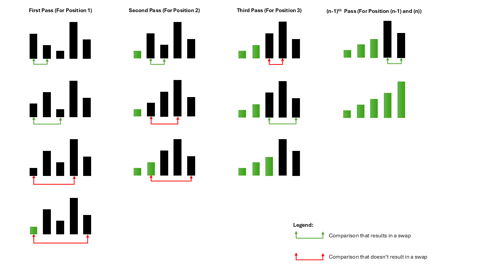

<h1>
  <span class="headline">Selection Sort in Java</span>
  <span class="subhead">Selection Sort</span>
</h1>

**Learning objective:** By the end of this lesson, you'll be able to explain a selection sort algorithm.

## Introduction to selection sort
Selection Sort is a simple comparison-based sorting algorithm. It repeatedly compares two elements and selects the smallest (or largest) element from the unsorted part of the array and places it in its correct position.



### Characteristics of selection sort algorithm
- **Comparison-based**: It compares every pair of elements in a dataset to find the minimum.
- **In-place**: Sorting is done within the array. No extra space is required.
- **Unstable**: It doesn't guarantee the same order for elements with the same values in the sorted array as in the input array.
- **Iterative**: It involves nested loops for selecting the minimum value and placing it in the correct position.

## Pseudocode for selection sort
```plaintext
FUNCTION SelectionSort(array):
    SET n = length of array
    FOR i FROM 0 TO n-1:
        SET minIndex = i
        FOR j FROM i+1 TO n:
            IF array[j] < array[minIndex]:
                SET minIndex = j
        EXECUTE SWAP (array[i], array[minIndex])
```

## Time complexity of selection sort
For each element in the array, the algorithm searches through the remaining part of the array to find the minimum value, leading to a time complexity of O(N^2).

## Space complexity of selection sort
Since it's an in-place sorting algorithm, its space complexity is O(1), requiring no additional space beyond the input array.

## Advantages of selection sort
- **Simplicity**: The algorithm is straightforward and easy to understand and implement.
- **Memory efficiency**: Selection sort sorts the array in place, requiring no additional memory allocation.
- **Performance on small lists**: It performs adequately for small arrays.

## Drawbacks of selection sort
- **Inefficient for large data**: Time complexity of O(n^2) makes it unsuitable for large datasets.
- **Unstable sorting**: Original order of equal elements might not be maintained.
- **No early exit**: Always performs n(n−1)/2 comparisons, even if the array is sorted.